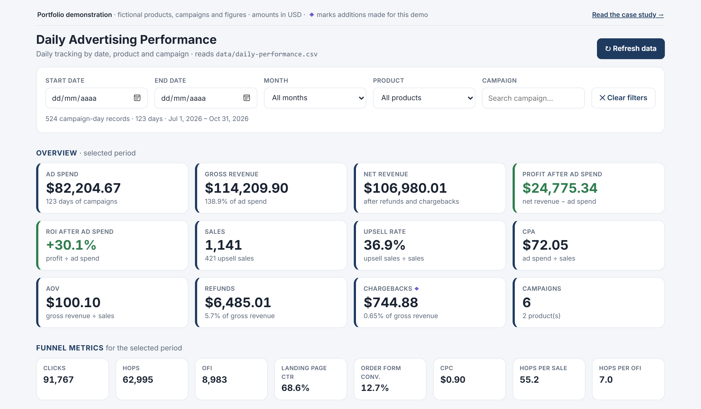
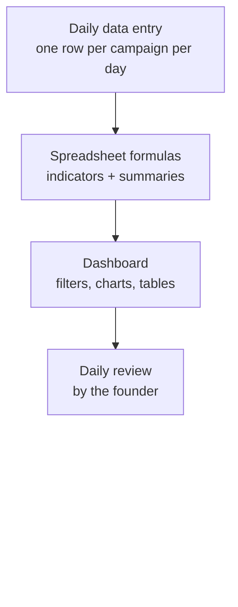
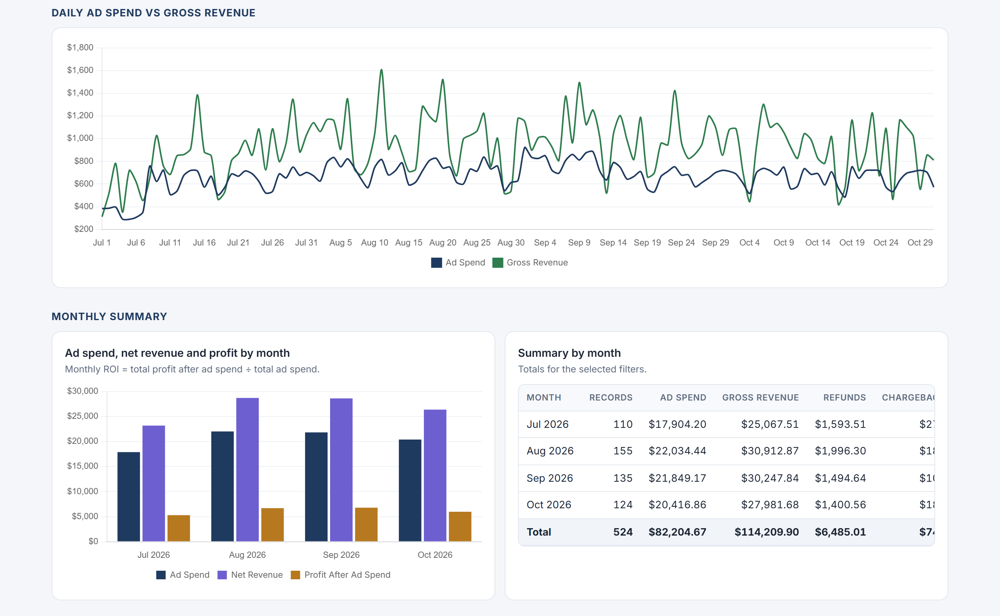
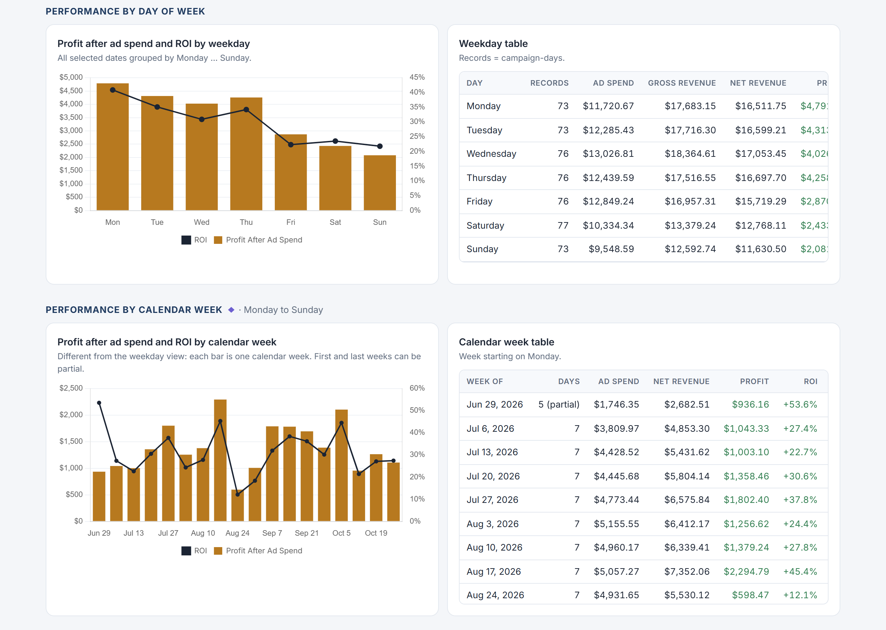
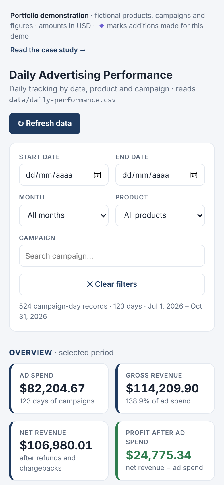

# Daily Advertising Tracking & Reporting

I built a spreadsheet to record daily advertising data, calculate performance indicators, and track campaign results, together with the dashboard that reads it. The founder checked the dashboard every day to see results by period, product and campaign. This public demo recreates the system with fictional products, campaigns and figures.

### **[→ Open the live dashboard](https://camilanacli.github.io/daily-advertising-tracking-reporting/)**

[Download the demo spreadsheet (.xlsx)](https://raw.githubusercontent.com/CamilaNacli/daily-advertising-tracking-reporting/main/spreadsheet/advertising-performance-demo.xlsx)

> **Professional Portfolio Demonstration** — This project is a portfolio demonstration based on a solution I developed and used in a real professional environment. All names, records, financial information, and other data presented are fictional and have been created exclusively for demonstration purposes. Original business information has been excluded to protect confidentiality. This demonstration showcases my practical experience, problem-solving skills, and ability to design and implement operational solutions using digital tools. *Amounts are shown in USD.*

---

## My role

- **Data tracking:** I recorded the daily figures for each campaign — ad spend, gross revenue, refunds, clicks, sales-page visits, order-form views, sales and upsell sales.
- **Indicators:** I designed the spreadsheet formulas that turn those inputs into profit after ad spend, ROI, CPA, AOV, conversion rates and monthly, weekday and campaign summaries.
- **Reporting:** I built the dashboard the founder used every day to check results for any period, product or campaign.

> This project focuses on data tracking, reporting and dashboard development.

## How it works

1. **Record** — each day, one row per active campaign with the inputs above.
2. **Calculate** — formulas compute the indicators; **N/A** is shown when a denominator is zero (for example, CPA on a day without sales).
3. **Summarize** — monthly, day-of-week and campaign tabs add up the daily rows.
4. **Review** — the dashboard reads the data and answers questions such as *“How did last week compare?”* or *“Which campaign is losing money this month?”*

## Key rules

| Metric | Rule |
| --- | --- |
| **Net Revenue** | Gross Revenue − Refunds − Chargebacks |
| **Profit After Ad Spend** | Net Revenue − Ad Spend |
| **ROI** (after ad spend) | Profit After Ad Spend ÷ Ad Spend |
| **Monthly ROI** | Total profit for the month ÷ total ad spend for the month (not an average of daily ROIs) |
| **CPA / AOV** | Ad Spend ÷ Sales / Gross Revenue ÷ Sales |

Refunds and chargebacks are recorded in **separate columns**, so the same adjustment is never deducted twice. All metric definitions: **[docs/metrics.md](docs/metrics.md)**.

**Demo result:** in this fictional dataset (Jul–Oct 2026, USD), monthly ROI stays close to **+30%** (29.3% to 31.1%), while 19 days and one campaign in August are negative. These figures exist only in the fictional demo and do not describe real results.

## Dashboard features

- **Filters:** start date, end date, month, product and campaign search, with *Clear filters*.
- **Overview:** ad spend, gross revenue, net revenue, profit after ad spend, ROI, sales, upsell rate, CPA, AOV, refunds and chargebacks (with their share of gross revenue).
- **Funnel metrics:** clicks, hops, order-form impressions (OFI), landing page CTR, order form conversion, CPC, hops per sale and hops per OFI.
- **Daily ad spend vs gross revenue** chart.
- **Monthly summary:** chart and table with totals.
- **Performance by Day of Week:** Monday … Sunday across the selected dates.
- **Performance by Calendar Week** ◆ — each Monday-to-Sunday week as its own bar (a demo addition, separate from the weekday view).
- **Daily detail by campaign:** one row per campaign per day, 30 rows per page.

## Demo spreadsheet

| Tab | Content |
| --- | --- |
| **About** | Notice and metric rules |
| **Daily Data** | Inputs (white) and formulas (grey): one row per campaign per day |
| **Monthly Summary** | Totals and ROI by month |
| **Day of Week** | Totals and ROI by weekday |
| **Calendar Week** ◆ | Totals and ROI by Monday-to-Sunday week |
| **By Campaign** | Totals and ROI by campaign |

The dashboard reads the same data from [`data/daily-performance.csv`](data/daily-performance.csv).

## Tools

Google Sheets / Excel formulas · HTML, CSS and JavaScript · Chart.js · GitHub Pages.

## Documentation

| Document | Content |
| --- | --- |
| [docs/metrics.md](docs/metrics.md) | Every metric, its formula and the N/A rule |
| [docs/demo-environment.md](docs/demo-environment.md) | What is fictional, what changed from the original and what was left out |

◆ marks additions made for this demo.
